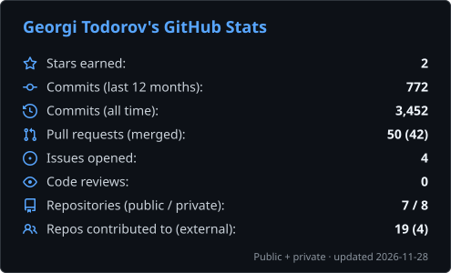
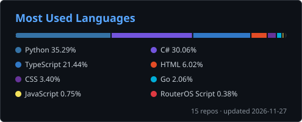

```
{}, [], (), +, -, *, /,
<, >, <=, >=, ==, !=,
&&, ||, !, =, ,, ;,
", '

Symbols are important because they allow us to convey
complex ideas and communicate in a concise and efficient manner.

Символите имат голямо значение, тъй като ни улесняват изразяването на сложни идеи и
позволяват ефективна комуникация в съкратен формат.
```

[Facts](https://github.com/GVLTodorov/GVLTodorov/tree/main/tutorials/facts)

[Tutorials](https://github.com/GVLTodorov/GVLTodorov/tree/main/tutorials)

[Runner](https://github.com/GVLTodorov/Runner)

[Cronner](https://github.com/GVLTodorov/Cronner)

[Exporrters](https://github.com/GVLTodorov/Exporrters)

[Monorepo](https://github.com/GVLTodorov/Monorepo)

[Workshop](https://github.com/GVLTodorov/Workshop)

### Stats





### Trophies


🔭 .Net / DevOps / Docker

[](https://www.linkedin.com/in/gvltodorov/)

<a href="https://www.buymeacoffee.com/gvltodorov" target="_blank"></a>
